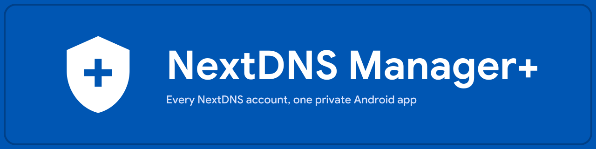

<div align="center">
  

  <h3>Every AdGuard DNS account in one small, private Android app.</h3>

  <p>
    <a href="../../releases/latest"><picture><source media="(prefers-color-scheme: dark)" srcset="artwork/readme/get-github-dark.svg"></picture></a>
    <!-- Un-comment when the app is listed (fdroid.md), and put the public repository's address into the Obtainium link:
    <a href="https://f-droid.org/packages/org.rafee_m.adguardmanager/"><picture><source media="(prefers-color-scheme: dark)" srcset="artwork/readme/get-fdroid-dark.svg"></picture></a>
    <a href="https://apps.obtainium.imranr.dev/redirect?r=obtainium://add/https://github.com/UpperPanda1/adguard-manager"><picture><source media="(prefers-color-scheme: dark)" srcset="artwork/readme/get-obtainium-dark.svg"></picture></a>
    -->
  </p>
  <p>
    <picture><source media="(prefers-color-scheme: dark)" srcset="artwork/readme/chip-android-dark.svg"></picture>
    <picture><source media="(prefers-color-scheme: dark)" srcset="artwork/readme/chip-webview-dark.svg"></picture>
    <a href="../../releases/latest"><picture><source media="(prefers-color-scheme: dark)" srcset="artwork/readme/chip-release-dark.svg"></picture></a>
    <picture><source media="(prefers-color-scheme: dark)" srcset="artwork/readme/chip-apk-dark.svg"></picture>
    <a href="LICENSE"><picture><source media="(prefers-color-scheme: dark)" srcset="artwork/readme/chip-license-dark.svg"></picture></a>
  </p>

  <p>
    The AdGuard DNS dashboard with a native top bar: several accounts signed in side by side, a live<br>
    "am I using AdGuard DNS?" icon, app lock and find in page, in an app of about 190 KB.
  </p>

  <p>
    <a href="#status"><b>Status</b></a> ·
    <a href="#features"><b>Features</b></a> ·
    <a href="#sign-in-with-apple-google-or-facebook"><b>Sign-in</b></a> ·
    <a href="#what-the-app-adds-and-what-webview-decides"><b>WebView</b></a> ·
    <a href="#privacy"><b>Privacy</b></a> ·
    <a href="BUILDING.md"><b>Build it yourself</b></a> ·
    <a href="#license"><b>License</b></a>
  </p>
</div>

---

## Why AdGuard Manager?

Managing more than one AdGuard DNS account on a phone means signing out and in again, or a browser full of private
tabs. AdGuard Manager keeps each account in its own sealed container, so they stay signed in **at the same time** and
never see each other's data; one tap on the numbered chip in the top bar switches between them, and the page you left
is still there when you come back.

It shows the real AdGuard DNS dashboard (`adguard-dns.io`), so every server, device, rule and query log the website has
is there, and nothing has to wait for an app update when AdGuard adds something. Around it the app adds what a browser
tab can't: the connection-status icon, app lock, a theme that matches the dashboard, and one-tap tools.

## Status

> **Early development (version 0.1), not ready to use with AdGuard yet.** The app was created on 2026-11-19 as a copy
> of its sibling [NextDNS Manager+](https://github.com/UpperPanda1/nextdnsmanager-plus) and is being adapted step by
> step ([the plan](docs/ADGUARD_PLAN.md)). Done so far: the shared app (accounts, tabs, lock, settings…), research of
> the live AdGuard website, the new name, id and icon. **The app still opens the NextDNS dashboard** until the next step
> (pointing it at AdGuard). Built, unit-tested and linted on every change; **not yet tested on a phone**.

| Step | State |
|---|---|
| Shared app copied from NextDNS Manager+ (accounts, tabs, app lock, find, desktop site, pinch zoom, theme, downloads) | ✅ |
| Research of the live AdGuard DNS website ([findings](docs/research/2026-11-19-adguard-live-probe.md)) | ✅ |
| Name **AdGuard Manager**, app id `org.rafee_m.adguardmanager`, own icon | ✅ |
| Opens the AdGuard DNS dashboard; AdGuard's colours | next |
| Sign-in with Apple, Google and Facebook | planned |
| "Am I using AdGuard DNS?" icon from AdGuard's own check | planned |
| Saving the dashboard's exported files (e.g. user rules) | planned |
| Store texts, release, F-Droid | planned |

## Features

What the finished app does. Everything under *several accounts*, *private and locked* and *made for Android* already
works in the code (shared with NextDNS Manager+); AdGuard-specific parts are marked *(planned)*.

### Several accounts, side by side
- **Up to 20 AdGuard accounts**, each signed in separately in its own container (cookies, storage and cache never mix).
- **Numbered account chip** in the top bar: tap to switch; the menu shows which accounts are loaded and lets you close
  one, and has Reload, Desktop site, Hide status bar and Clear cache at hand.
- **Accounts kept loaded:** choose 1–10 (default 3). Switching between loaded accounts is instant; the one used longest
  ago is closed first and reopens from its cache when you pick it again.
- Rename, reorder (drag), sign out or remove accounts in Settings. Signing out or removing deletes that account's data
  on the phone.

### Knows whether AdGuard DNS is working *(planned)*
- **Connection-status icon:** green tick when this phone uses AdGuard DNS with encryption, warning sign otherwise; tap it
  for the explanation. It uses the same check as AdGuard's own dashboard (a name only AdGuard DNS can answer), when the
  network changes and only while the app is on screen.
- A **Private DNS shortcut** to Android's network settings (your personal server is `<device id>.d.adguard-dns.com`).

### Private and locked
- **App lock** with your fingerprint, face or screen-lock PIN; it asks again after a minute away. While it is on,
  screenshots and the recent-apps preview of the app are blank.
- No ads, no analytics, no crash reporting, no Google Play Services. See [Privacy](#privacy).

### Made for Android
- **White, Black or Match system** theme for the app; the status bar takes the page's colour (or hide the status bar).
- **Find in page**, **desktop site** per account, **pinch to zoom** (the dashboard normally forbids it).
- **Downloads:** files the dashboard makes itself, such as exported user rules, are saved to Downloads *(planned)*;
  files on AdGuard's servers open in your browser.
- **Clear cache** for every account at once, without signing anyone out; Settings shows how much space it uses.
- One library (AndroidX WebKit), about 190 KB to download.

## Sign in with Apple, Google or Facebook

*(planned)* AdGuard's login page offers e-mail, Apple, Google and Facebook. All four will work inside the account's
container, so each account can use a different login. One thing you should know: **Google refuses to show its sign-in
page inside apps** (AdGuard even asks Google to). While — and only while — Google's sign-in page
(`accounts.google.com`) is on screen, the app therefore tells it that it is a desktop Linux browser, as the
[geminiAssist](https://github.com/AcideFluorhydrique/geminiAssist) app does. Every other page, AdGuard's included,
sees the app's real identity. No Google, Apple or Facebook code is in the app: the sign-in happens on their websites.

## What the app adds, and what WebView decides

AdGuard Manager shows the website in **Android System WebView**, the browser engine your phone already has. Some
features depend on that engine's version, not on the app:

| Feature | Needs | Without it |
|---|---|---|
| **Several accounts** (one container each) | WebView **119 or newer** (WebView "profiles") | one account only; Settings says so. Update *Android System WebView* through your app store |
| Cache limit of 20 MB per account | a WebView with cache control | WebView uses its own limit |
| Find-in-page matches in the app's colour | WebView 144 or newer | Chromium's yellow/orange highlight |
| Desktop site and pinch to zoom from the first frame | a WebView that runs scripts at page start | applied right after the page loads |

What stays the **website's** job: the dashboard's look, servers, devices, rules, logs and statistics, and its own dark
mode. AdGuard's dashboard follows the phone's light/dark setting only when your AdGuard account's theme is set to
*Automatic* (AdGuard dashboard → Account settings); otherwise it keeps the theme you chose there.

**Battery:** pages of accounts you aren't looking at are paused, and loaded accounts are limited by *Accounts kept
loaded*. The dashboard keeps no live connection to its server; its own timers (e.g. the query log's auto-refresh,
off unless you switch it on) are slowed down by WebView while the page is hidden.

## Download

<p align="center">
  <a href="../../releases/latest"><picture><source media="(prefers-color-scheme: dark)" srcset="artwork/readme/get-github-dark.svg"></picture></a>
</p>

- **No release yet** (see [Status](#status)). Test builds: every push's CI run has the APKs as an artifact.
- **Requirements:** Android 10 or newer and an AdGuard DNS account. Several accounts need *Android System WebView* 119+.
- **F-Droid:** planned; what it takes is in [`fdroid.md`](fdroid.md).

## Privacy

Once the app opens AdGuard (see [Status](#status)):

- The app talks only to **AdGuard**: the dashboard you open, and one small request to AdGuard's DNS check
  (`…-dnscheck.adguard-dns.com`) when you open the app or your network changes (for the status icon; it carries no
  account data). If you sign in with Apple, Google or Facebook, their sign-in pages are opened too, inside that account.
- No analytics, tracking or crash reports from the app; WebView's own usage statistics are switched off. (AdGuard's
  website has its own; see its privacy policy.)
- Your logins stay on the phone, in each account's container, and are left out of Android's backups.
- Links to other websites open in your browser, never inside an account.

Not affiliated with or endorsed by AdGuard. "AdGuard" is a trademark of its owner.

## Build it yourself

Everything you need (JDK, Android SDK, tests, checks, reproducible builds) is in **[BUILDING.md](BUILDING.md)**. The
short version:

```bash
./gradlew assembleDebug        # app/build/outputs/apk/debug/
```

How releases are made and signed: [RELEASE.md](RELEASE.md). How the app is put together and how to change it:
[PROJECT.md](PROJECT.md). What changed: [CHANGES.md](CHANGES.md).

## Credits

A copy of [NextDNS Manager+](https://github.com/UpperPanda1/nextdnsmanager-plus) by Rafee-M, which is built on
[LLM Central](https://github.com/UpperPanda1/assist) by Rafee-M (accounts, tabs, settings) and features of
[NextDNS Manager](https://github.com/doubleangels/nextdnsmanager) by doubleangels. Icons: Material Icons (Apache License
2.0) and [Simple Icons](https://simpleicons.org) (CC0); the README badges follow the design of
[Flow](https://github.com/Flow-Tube/Flow)'s, re-drawn by `tools/readme-badges` in the app icon's blue.

## License

Free software under the [GNU General Public License v3.0](LICENSE).
